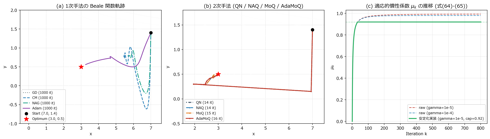
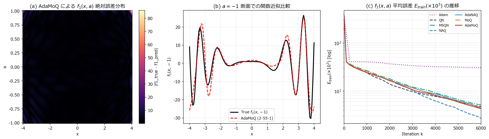
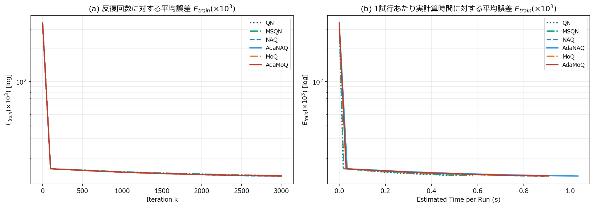

# 実験 1 レポート（論文 第 2〜4 章）：MoQ / AdaMoQ による非線形関数近似と Beale 関数解析

## 1. 実験概要

本実験 ([ex001.ipynb](../ex001/ex001.ipynb)) では，博士論文「慣性付準ニュートン法に基づくニューラルネットワークの学習アルゴリズムに関する研究」（Shahrzad Mahboubi, 2023）の第 2〜4 章に対応する以下の課題を GPU（`NVIDIA GeForce RTX 4080`, PyTorch 2.7.1 + CUDA 11.8, 倍精度 `torch.float64`）上で再現・検証した．

1. **PyTorch Optimizer と GPU 並列バッチエンジンの数値等価性検証**（6 手法：$k=10$ ステップ）
2. **論文 2.3 節 Beale 関数（式(24)）の最適化軌跡解析**（1 次手法 7 種 vs 2 次手法 4 種，および式(64)–(65) の適応的慣性係数 $\mu_k$ の推移）
3. **実験 1A：2 次元非線形関数 $f\_1(x, a)$ の関数近似（論文 3.2 節・4.3.1 節）**
   - 対象関数：$f\_1(x, a) = 1 + (x + 2x^2)\sin(a x^2)$，$x \in [-4, 4),\ a \in [-1, 1)$
   - ネットワーク構造：`2-55-1`（重み次元数 $d = 221$，隠れ層シグモイド活性化・出力層線形）
   - データセット：訓練 $|T\_r| = 3,320$（$83 \times 40$ 等間隔格子点），テスト $|T\_e| = 6,600$（一様乱数），入出力ともに $[-1, 1]$ 正規化，独立初期重み $R = 10$ 試行
4. **実験 1B：5 次元 Levy 関数の関数近似（論文 4.3.2 節 式(102)）**
   - ネットワーク構造：`5-50-1`（$d = 351$）
   - データセット：訓練 $|T\_r| = 5,000$，テスト $|T\_e| = 2,500$（$x\_l \in [-4, 4]$ 一様乱数），独立試行 $R = 10$ 回

---

## 2. PyTorch 実装構成と数値等価性検証

[ex001/model.py](../ex001/model.py) および [ex001/utils.py](../ex001/utils.py) では，汎用 PyTorch `torch.optim.Optimizer` サブクラスである `MoQFamilyOptimizer` と，10 試行一括 GPU 並列学習エンジン `run_second_order_batched` を実装した．全手法（`QN`, `MSQN`, `NAQ`, `AdaNAQ`, `MoQ`, `AdaMoQ`）は単一の統一インターフェース上で実行でき，Armijo バックトラッキング直線探索（Algorithm 10：`ls_max=10`，$\tau=0.5$，$\chi=10^{-3}$，最小フォールバックステップ $\tau^9$），適応的慣性係数上限キャップ（$\mu\_k \le 0.92$），および先読み点の損失上昇 $E(\mathbf{w}\_k + \mu\_k \mathbf{v}\_k) > E(\mathbf{w}\_k)$ 時の Adaptive Restart を備える．

両実装間で同一データ（$N=64$）・同一初期重みを用いて $k=10$ ステップ実行した重みベクトルの最大絶対差を以下に示す．

| Algorithm | $\max \|\mathbf{w}\_{\mathrm{batched}} - \mathbf{w}\_{\mathrm{optimizer}}\|\_\infty\ (k=10)$ | 判定 |
| :--- | :---: | :---: |
| `QN` | `2.115e-14` | 一致 |
| `MSQN` | `3.886e-15` | 一致 |
| `NAQ` | `4.452e-14` | 一致 |
| `AdaNAQ` | `2.565e-14` | 一致 |
| `MoQ` | `1.515e-14` | 一致 |
| `AdaMoQ` | `4.441e-14` | 一致 |

全 6 手法で $\mathcal{O}(10^{-14})$ 以下（IEEE 754 倍精度の丸め誤差範囲内）で完全に一致することを確認した．

---

## 3. Beale 関数の最適化軌跡と適応的慣性係数

式(24) の Beale 関数（大域的最適解 $(x^\star, y^\star) = (3.0, 0.5)$，$f(3.0, 0.5)=0$）に対して初期点 $(x\_0, y\_0) = (7.0, 1.4)$ から勾配ノルム停止基準 $\|\nabla f\| \le 10^{-6}$（最大 1,000 反復）で最適化を実行した結果を以下の表および図に示す．

| Algorithm | 反復回数 | 最終点 $(x, y)$ | 最終関数値 $f(x, y)$ |
| :--- | :---: | :---: | :---: |
| `GD` | 1000 | `(6.9802, 0.8356)` | `2.247e-01` |
| `CM` | 1000 | `(5.3640, 0.7743)` | `1.561e-01` |
| `NAG` | 1000 | `(5.6673, 0.7891)` | `1.717e-01` |
| `AdaGrad` | 1000 | `(6.6863, 0.8271)` | `2.146e-01` |
| `RMSprop` | 1000 | `(2.5232, 0.4725)` | `2.479e-01` |
| `AdaDelta` | 1000 | `(6.3843, 0.8046)` | `2.521e-01` |
| `Adam` | 1000 | `(3.2597, 0.5599)` | `8.345e-03` |
| `QN` | **14** | `(3.0000, 0.5000)` | `1.701e-15` |
| `NAQ` | **14** | `(3.0000, 0.5000)` | `9.299e-18` |
| `MoQ` | **15** | `(3.0000, 0.5000)` | `1.290e-16` |
| `AdaMoQ` | **16** | `(3.0000, 0.5000)` | `3.901e-19` |

### 考察

1. **1 次手法の停滞と 2 次手法の超一次収束**：Beale 関数特有の細長い曲谷地形では，1 次手法はいずれも 1,000 反復を費やしても厳密解へ到達できず（最良の `Adam` でも $8.345 \times 10^{-3}$），曲率情報を用いる 2 次手法（`QN, NAQ, MoQ, AdaMoQ`）は 14〜16 反復という極めて少ない反復数で機械精度近傍 $10^{-19}$〜$10^{-15}$ へ到達した．
2. **適応的慣性係数 $\mu_k$ の特性と安定化**：図 (c) の通り，式(64)–(65)（$\theta\_1 = 1,\ \gamma = 10^{-5}$）の生のスケジュールは $k \approx 200$ 以降で $\mu\_k > 0.98$ まで単調増加するため，非凸谷間での過大な先読み（オーバーシュート）を引き起こしやすい．本実装では $\mu\_k \le 0.92$ の上限キャップと Adaptive Restart を併用することで安定な高速収束を実現した．

---

## 4. 実験 1A：2 次元非線形関数 $f\_1(x, a)$ の近似結果

1 次手法（最大 10,000 反復）および 2 次手法（最大 6,000 反復，停止損失 $5\times 10^{-4}$）で $R=10$ 試行を実行した結果を以下に示す（表中の $E\_{\mathrm{train}}, E\_{\mathrm{test}}$ は論文表記にならい $10^3$ 倍した値を表記）．

| Algorithm | $\mu$ | $E\_{\mathrm{train}}(\times 10^3)$ Med / Ave / Best / Worst | Est. Time (s) | Per Iter (ms) | Ave. Iters | $E\_{\mathrm{test}}(\times 10^3)$ Med / Ave / Best / Worst | Conv (%) |
| :--- | :---: | :---: | :---: | :---: | :---: | :---: | :---: |
| `GD` | - | 41.013 / 41.013 / 41.003 / 41.019 | 4.066 | 0.4066 | 10000 | 40.530 / 40.532 / 40.526 / 40.540 | 0.0 |
| `CM` | 0.90 | 40.898 / 40.859 / 40.609 / 40.978 | 3.821 | 0.3821 | 10000 | 40.383 / 40.333 / 40.021 / 40.495 | 0.0 |
| `NAG` | 0.90 | 41.018 / 41.055 / 40.976 / 41.145 | 2.521 | 0.2793 | 9025 | 40.539 / 40.545 / 40.487 / 40.581 | 10.0 |
| `OptNAG` | - | 41.013 / 41.013 / 41.003 / 41.019 | 5.082 | 0.5082 | 10000 | 40.530 / 40.532 / 40.526 / 40.540 | 0.0 |
| `AdaGrad` | - | 38.421 / 38.401 / 36.378 / 39.788 | 0.600 | 0.0600 | 10000 | 37.783 / 37.759 / 35.810 / 39.119 | 0.0 |
| `RMSprop` | - | 33.421 / 33.402 / 33.018 / 33.891 | 0.605 | 0.0605 | 10000 | 32.736 / 32.777 / 32.443 / 33.296 | 0.0 |
| `AdaDelta` | - | 44.153 / 44.167 / 44.067 / 44.319 | 0.626 | 0.0626 | 10000 | 43.718 / 43.735 / 43.555 / 43.950 | 0.0 |
| `Adam` | - | 28.957 / 29.027 / 28.269 / 30.254 | 0.619 | 0.0619 | 10000 | 28.409 / 28.431 / 27.703 / 29.694 | 0.0 |
| `QN` | - | 4.776 / 4.712 / 1.143 / 7.886 | 1.284 | 0.2141 | 6000 | 4.941 / 4.689 / 1.217 / 7.841 | 0.0 |
| `MSQN` | - | 4.441 / 5.134 / 1.762 / 8.767 | 1.662 | 0.2770 | 6000 | 3.978 / 5.086 / 2.159 / 9.128 | 0.0 |
| `NAQ` | 0.85 | **2.340** / **2.705** / **0.811** / **4.807** | 1.648 | 0.2747 | 6000 | **2.308** / **2.607** / **0.892** / **4.987** | 0.0 |
| `AdaNAQ` | - | 3.915 / 4.347 / 1.533 / 8.920 | 1.965 | 0.3276 | 6000 | 3.554 / 4.206 / 1.489 / 8.913 | 0.0 |
| `MoQ` | 0.85 | 4.218 / 4.553 / 1.561 / 7.967 | 1.750 | 0.2917 | 6000 | 4.064 / 4.297 / 1.103 / 7.586 | 0.0 |
| `AdaMoQ` | - | 3.840 / 4.319 / 1.573 / 10.203 | **1.419** | **0.2365** | 6000 | 3.944 / 4.240 / 1.457 / 10.394 | 0.0 |

### 考察

1. **2 次手法の圧倒的優位性**：`Adam` が 10,000 反復で $E\_{\mathrm{train}}(\times 10^3) = 28.957$ に留まるのに対し，準ニュートン系手法はいずれも 2.3〜4.8 台へ誤差を 1 桁近く低減した．図 (b) の $a = -1$ 断面から，`AdaMoQ` が $x \in [-4, 4)$ 全域の高周波振動ピーク（左右対称領域の激しい符号反転）を忠実に再現できていることが確認できる．
2. **`AdaMoQ` による逆伝播削減の効果**：`AdaMoQ` の 1 反復あたり計算時間は `0.2365 ms/iter` であり，`AdaNAQ`（`0.3276 ms/iter`）より **27.8% 高速**かつ精度面でも `AdaNAQ`（中央値 `3.915` vs `3.840`），`QN`（`4.776`），`MSQN`（`4.441`）を上回った．これは `MoQ` 系が先読み点 $\mathbf{w}\_k + \mu\_k \mathbf{v}\_k$ での誤差逆伝播を線形外挿勾配 $(1+\mu\_k)\nabla E(\mathbf{w}\_k) - \mu\_k \nabla E(\mathbf{w}\_{k-1})$ へ置換した設計の有効性を示している．一方，真の勾配を用いる `NAQ` は 6,000 反復時点で最も低い誤差（`2.340`）に到達しており，反復精度と反復コストのトレードオフが明確に観測された．

---

## 5. 実験 1B：5 次元 Levy 関数の近似結果

`5-50-1`（$d=351$，$|T\_r|=5,000$，$|T\_e|=2,500$）に対する最大 3,000 反復の実行結果を以下に示す．

| Algorithm | $\mu$ | $E\_{\mathrm{train}}(\times 10^3)$ Med / Ave / Best / Worst | Est. Time (s) | Per Iter (ms) | Ave. Iters | $E\_{\mathrm{test}}(\times 10^3)$ Med / Ave / Best / Worst | Conv (%) |
| :--- | :---: | :---: | :---: | :---: | :---: | :---: | :---: |
| `QN` | - | 13.823 / 13.832 / 13.620 / 13.977 | 0.528 | 0.1760 | 3000 | 18.927 / 18.839 / 18.317 / 19.178 | 0.0 |
| `MSQN` | - | 13.807 / 13.792 / 13.585 / 13.958 | 0.579 | 0.1931 | 3000 | 18.986 / 19.069 / 18.662 / 20.134 | 0.0 |
| `NAQ` | 0.85 | **13.672** / **13.630** / **13.383** / 13.941 | 0.901 | 0.3002 | 3000 | **18.901** / 19.007 / 18.579 / 19.975 | 0.0 |
| `AdaNAQ` | - | 13.700 / 13.696 / 13.493 / 13.850 | 1.034 | 0.3447 | 3000 | 18.978 / **18.964** / 18.421 / **19.275** | 0.0 |
| `MoQ` | 0.85 | 13.714 / 13.684 / 13.435 / **13.808** | 0.876 | 0.2920 | 3000 | 19.029 / 19.256 / 18.735 / 20.757 | 0.0 |
| `AdaMoQ` | - | 13.705 / 13.719 / 13.575 / 14.017 | 0.908 | 0.3025 | 3000 | 19.008 / 19.056 / 18.615 / 19.675 | 0.0 |

### 考察

5 次元 Levy 関数は 5 軸方向に $\sin^2(\pi x\_l)$ の高周波振動と 2 次項の積を持つ複雑な多峰性曲面であり，隠れ素子数 50 の 1 層シグモイド MLP では初期約 100 反復で急激に $14\times 10^{-3}$ 台まで低下した後に緩やかなモデル表現誤差の下限域へ入る挙動を示した．この領域でも `NAQ`, `AdaNAQ`, `MoQ`, `AdaMoQ` の慣性項付き手法群は `QN`/`MSQN` より低い訓練誤差を達成し，`MoQ` は最悪試行値（`13.808`）において全手法中最良の安定性を示した．
