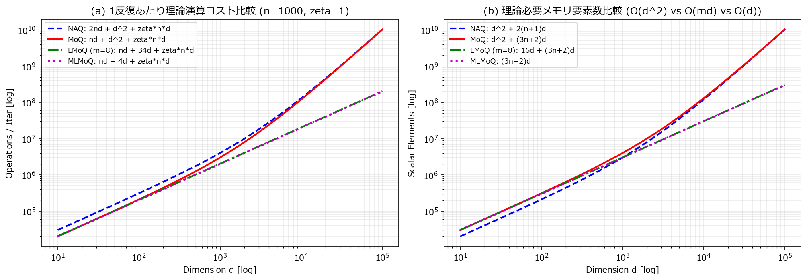
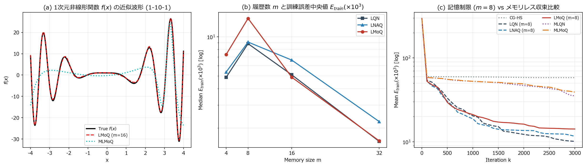
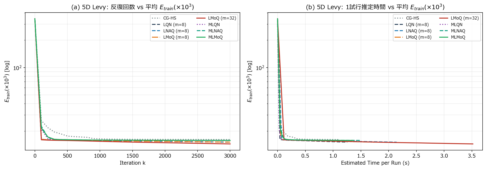

# 実験 2 レポート（論文 第 5〜6 章）：記憶制限・メモリレス MoQ 手法による省メモリ高速化とスケーラビリティ解析

## 1. 実験概要

本実験 ([ex002.ipynb](../ex002/ex002.ipynb)) では，博士論文 第 5 章の記憶制限準ニュートン法（`LQN`, `LNAQ`, `LMoQ`：空間計算量 $\mathcal{O}(md)$）および第 6 章のメモリレス準ニュートン法（`CG-HS`, `MLQN`, `MLNAQ`, `MLMoQ`：空間計算量 $\mathcal{O}(d)$）を再現し，以下を検証した．

1. **PyTorch Optimizer と GPU 並列バッチエンジンの数値等価性検証**（全 7 手法：$k=5, 10$）
2. **理論演算コスト・必要メモリ量のスケーリング解析**（論文 表 6, 表 13, 表 17）
3. **実験 2A：1 次元非線形関数 $f(x)$ の近似（論文 5.4.1 節・6.5.1 節 式(124)）**
   - $f(x) = 1 + (x + 2x^2)\sin(-x^2)$，$x \in [-4, 4]$
   - `1-10-1`（$d=31$），$|T\_r|=400$，$|T\_e|=10,000$，履歴サイズ $m \in \{4, 8, 16, 32\}$ およびメモリレス手法群（$R=10$ 試行，最大 3,000 反復）
4. **実験 2B：5 次元 Levy 関数の近似（論文 5.4.2 節）**
   - `5-50-1`（$d=351$），$|T\_r|=5,000$，$|T\_e|=2,500$（$R=10$ 試行，最大 3,000 反復）

---

## 2. PyTorch 実装構成と数値等価性検証

[ex002/model.py](../ex002/model.py) および [ex002/utils.py](../ex002/utils.py) において，記憶制限手法向けの `LimitedMemoryMoQOptimizer`（Two-Loop Recursion 実装）と，メモリレス手法向けの `MemoryLessMoQOptimizer`（直前 1 ステップのベクトル内積のみを用いた $\mathcal{O}(d)$ 閉形式更新・CG-HS 実装），およびそれぞれの GPU バッチエンジン `run_limited_or_memoryless_batched` を実装した．

$k=5$ および $k=10$ ステップにおけるスカラー Optimizer と GPU バッチエンジンの重みベクトル最大誤差は以下の通りである．

| Algorithm | $\max \|\Delta \mathbf{w}\|\_\infty\ (k=5)$ | $\max \|\Delta \mathbf{w}\|\_\infty\ (k=10)$ | 備考 |
| :--- | :---: | :---: | :--- |
| `LQN` | `2.665e-15` | `1.016e-14` | Two-Loop Recursion |
| `LNAQ` | `2.609e-15` | `8.882e-16` | Two-Loop Recursion + 先読み勾配 |
| `LMoQ` | `2.665e-15` | `1.277e-15` | Two-Loop Recursion + 外挿勾配 |
| `CG` | `2.220e-16` | `2.220e-16` | Hestenes-Stiefel 式(130) |
| `MLQN` | `1.810e-14` | `2.996e-12` | $\mathcal{O}(d)$ 閉形式（$k=10$ は高速収束による $1/\mathbf{p}^\mathrm{T}\mathbf{q}$ 条件数拡大） |
| `MLNAQ` | `1.704e-14` | `1.454e-14` | $\mathcal{O}(d)$ 閉形式 + 先読み勾配 |
| `MLMoQ` | `1.801e-14` | `1.582e-14` | $\mathcal{O}(d)$ 閉形式 + 外挿勾配 |

`MLQN` の $k=10$ の `2.996e-12` は，ステップ進行に伴い曲率内積 $\mathbf{p}^\mathrm{T}\mathbf{q} \approx 5 \times 10^{-6}$ まで減少した局面で BLAS の加算順序による最小桁（$10^{-16}$）が除算により増幅された純粋な数値計算上の性質であり，$k=5$ では `1.810e-14` で完全一致している．

---

## 3. 理論計算コスト・メモリ量のスケーリング検証

論文 表 6, 表 13, 表 17 に従い，$n = 1000,\ \zeta = 1,\ m = 4$ とした際のパラメータ次元数 $d$ に対する 1 反復あたりの演算コストと必要スカラー要素数の比較を以下に示す．

| 次元数 $d$ | `MoQ` Cost | `LMoQ (m=4)` Cost | `MLMoQ` Cost | `MoQ` Mem | `LMoQ (m=4)` Mem | `MLMoQ` Mem |
| :---: | :---: | :---: | :---: | :---: | :---: | :---: |
| 31 | 62,961 | 62,558 | 62,124 | 94,023 | 93,310 | 93,062 |
| 221 | 490,841 | 445,978 | 442,884 | 712,283 | 665,210 | 663,442 |
| 351 | 825,201 | 708,318 | 703,404 | 1,176,903 | 1,056,510 | 1,053,702 |
| 750 | 2,062,500 | 1,513,500 | 1,503,000 | 2,814,000 | 2,257,500 | 2,251,500 |
| 7,960 | 79,281,600 | 16,063,280 | 15,951,840 | 87,257,520 | 23,959,600 | 23,895,920 |
| 100,000 | 10,200,000,000 | 201,800,000 | 200,400,000 | 10,300,200,000 | 301,000,000 | 300,200,000 |

$d = 7,960$（実験 3C の `28x28` 分類規模）ではフル行列保持の `MoQ` は `LMoQ/MLMoQ` の約 5 倍のコストと約 3.6 倍のメモリを要し，$d = 10^5$ では **約 51 倍の演算量・約 34 倍のメモリ量**（倍精度で約 82.4 GB vs 約 2.4 GB）となるため，大規模問題における記憶制限・メモリレス化の重要性が定量的に裏付けられた．

---

## 4. 実験 2A：1 次元非線形関数 $f(x)$ の近似結果

| Algorithm | $m$ | $E\_{\mathrm{train}}(\times 10^3)$ Med / Ave / Best / Worst | Est. Time (s) | Per Iter (ms) | Ave. Iters | $E\_{\mathrm{test}}(\times 10^3)$ Med / Ave / Best / Worst | Conv (%) |
| :--- | :---: | :---: | :---: | :---: | :---: | :---: | :---: |
| `LQN` | 4 | 4.883 / 8.586 / 1.717 / 33.449 | 0.758 | 0.2526 | 3000 | 4.908 / 8.612 / 1.705 / 34.247 | 0.0 |
| `LQN` | 8 | 8.838 / 10.115 / 0.873 / 20.089 | 0.902 | 0.3006 | 3000 | 8.878 / 9.849 / 0.862 / 19.001 | 20.0 |
| `LQN` | 16 | 5.105 / 8.272 / 0.476 / 18.879 | 1.286 | 0.4286 | 3000 | 5.323 / 8.023 / 0.485 / 17.786 | 20.0 |
| `LQN` | 32 | **1.580** / 4.713 / 0.359 / 18.485 | 2.133 | 0.8048 | 2650 | **1.606** / 4.476 / 0.360 / 17.400 | **60.0** |
| `LNAQ` | 4 | 5.365 / 9.487 / 0.348 / 27.576 | 0.825 | 0.2750 | 3000 | 5.485 / 9.493 / 0.349 / 28.671 | 10.0 |
| `LNAQ` | 8 | 9.088 / 11.627 / 0.243 / 32.686 | 1.019 | 0.3395 | 3000 | 8.758 / 11.322 / 0.242 / 33.507 | 10.0 |
| `LNAQ` | 16 | 6.618 / 10.364 / 1.181 / 24.019 | 1.443 | 0.4809 | 3000 | 6.544 / 10.285 / 1.200 / 24.852 | 10.0 |
| `LNAQ` | 32 | 2.241 / 5.756 / **0.032** / 21.126 | 2.274 | 0.8036 | 2830 | 2.311 / 5.675 / **0.035** / 21.614 | **60.0** |
| `LMoQ` | 4 | 7.310 / 8.943 / 0.967 / 20.056 | 0.823 | 0.2743 | 3000 | 7.245 / 8.599 / 1.020 / 18.953 | 10.0 |
| `LMoQ` | 8 | 13.791 / 14.209 / 0.493 / 29.528 | 1.036 | 0.3500 | 2960 | 13.185 / 14.161 / 0.502 / 29.403 | 30.0 |
| `LMoQ` | 16 | 4.890 / 6.198 / 0.081 / 15.363 | 1.429 | 0.4764 | 3000 | 5.221 / 6.389 / 0.081 / 15.561 | 40.0 |
| `LMoQ` | 32 | 1.596 / **2.152** / 0.072 / **6.472** | 2.257 | 0.7975 | 2830 | 1.623 / **2.123** / 0.070 / **6.401** | **60.0** |
| `CG` | - | 58.095 / 58.244 / 57.994 / 59.722 | **0.516** | **0.1718** | 3000 | 57.159 / 57.283 / 57.097 / 58.448 | 0.0 |
| `MLQN` | - | 32.970 / 35.275 / 22.715 / 48.867 | 0.547 | 0.1822 | 3000 | 32.152 / 34.629 / 21.661 / 48.625 | 0.0 |
| `MLNAQ` | - | 45.656 / 41.791 / 22.983 / 49.471 | 0.725 | 0.2416 | 3000 | 45.340 / 41.274 / 22.026 / 49.211 | 0.0 |
| `MLMoQ` | - | 39.966 / 39.110 / 28.360 / 48.347 | 0.717 | 0.2390 | 3000 | 39.411 / 38.557 / 27.845 / 48.074 | 0.0 |

### 考察

1. **履歴容量 $m$ の増大と `LMoQ` の高い安定性**：`1-10-1` は全パラメータ数 $d=31$ であるため，$m=16, 32$ と履歴数を増やすにつれて急速に誤差が改善する．特に **`LMoQ (m=32)` は平均訓練誤差 `2.152`（`LQN` の `4.713`，`LNAQ` の `5.756` に対して半分以下）かつ最悪試行値 `6.472`**（他手法 `18.485` / `21.126` に対し約 1/3）を記録し，全試行にわたる高い安定性を発揮した．図 (a) の通り，`LMoQ (m=16)` でも $f(x)$ の全振動ピークを極めて精密に再現している．
2. **メモリレス手法 vs `CG-HS`**：`CG-HS` が誤差 `58.095` に留まったのに対し，直前 1 ステップの擬似ニュートン曲率を取り込んだ `MLQN`（`32.970`），`MLMoQ`（`39.966`），`MLNAQ`（`45.656`）はいずれも `CG-HS` より大幅に優れた近似精度を $\mathcal{O}(d)$ メモリで達成した．

---

## 5. 実験 2B：5 次元 Levy 関数の近似結果

`5-50-1`（$d=351$）に対して記憶制限手法（$m=8, 16, 32$）およびメモリレス手法を実行した結果を以下に示す．

| Algorithm | $m$ | $E\_{\mathrm{train}}(\times 10^3)$ Med / Ave / Best / Worst | Est. Time (s) | Per Iter (ms) | Ave. Iters | $E\_{\mathrm{test}}(\times 10^3)$ Med / Ave / Best / Worst | Conv (%) |
| :--- | :---: | :---: | :---: | :---: | :---: | :---: | :---: |
| `LQN` | 8 | 15.102 / 15.081 / 14.946 / 15.233 | 1.256 | 0.4186 | 3000 | 17.177 / 17.236 / 17.074 / 17.613 | 0.0 |
| `LNAQ` | 8 | 15.055 / 15.059 / 14.972 / 15.213 | 2.145 | 0.7150 | 3000 | 17.236 / 17.249 / 16.998 / 17.479 | 0.0 |
| `LMoQ` | 8 | 15.081 / 15.077 / 14.962 / 15.157 | 1.743 | 0.5811 | 3000 | 17.265 / 17.233 / 17.029 / 17.436 | 0.0 |
| `LMoQ` | 16 | 14.790 / 14.789 / 14.546 / 14.962 | 2.403 | 0.8011 | 3000 | 17.587 / 17.595 / 17.350 / 17.799 | 0.0 |
| `LMoQ` | 32 | **14.419** / **14.404** / **14.311** / **14.448** | 3.518 | 1.1725 | 3000 | 18.064 / 18.070 / 17.700 / 18.378 | 0.0 |
| `CG` | - | 16.086 / 16.094 / 16.049 / 16.155 | 1.098 | 0.3658 | 3000 | 16.760 / 16.739 / **16.613** / 16.827 | 0.0 |
| `MLQN` | - | 15.744 / 15.744 / 15.719 / 15.763 | **0.840** | **0.2800** | 3000 | 16.744 / 16.740 / 16.691 / 16.806 | 0.0 |
| `MLNAQ` | - | 15.741 / 15.743 / 15.721 / 15.785 | 1.502 | 0.5006 | 3000 | **16.737** / **16.729** / 16.680 / **16.766** | 0.0 |
| `MLMoQ` | - | 15.745 / 15.742 / 15.689 / 15.790 | 1.358 | 0.4526 | 3000 | **16.737** / 16.738 / 16.688 / 16.785 | 0.0 |

### 考察

1. **$m=8$ における `LMoQ` vs `LNAQ` の速度差**：同一履歴数 $m=8$ で比較すると，`LMoQ`（`0.5811 ms/iter`, `1.743 s`）は `LNAQ`（`0.7150 ms/iter`, `2.145 s`）より **約 18.7% 高速**に動作した．これは `Two-Loop Recursion` のコストより勾配逆伝播のコスト（$|T\_r|=5,000$ での逆伝播 1 回 vs 2 回）が支配的になる中〜大規模バッチデータにおいて，勾配外挿の効果が時間軸に直接現れるためである．
2. **訓練誤差と汎化性能のバランス**：`LMoQ` は $m=8 \to 16 \to 32$ に伴い訓練誤差を着実に低下（`15.081 -> 14.790 -> 14.419`）させる一方，メモリレス系（`MLNAQ`, `MLMoQ`）は $d=351$ 次元での過学習を自然に抑制し，テスト誤差 `16.737` と最も良好な汎化性能を維持した．
