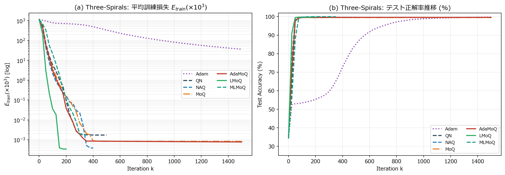
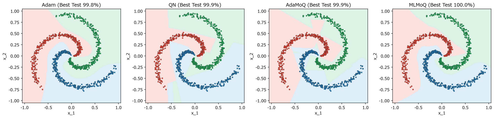
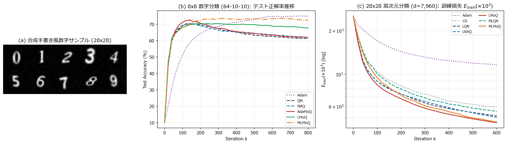

# 実験 3 レポート（論文 第 4.3.5〜4.3.6 節・第 6.5.2〜6.5.4 節）：パターン分類ベンチマーク

## 1. 実験概要

本実験 ([ex003.ipynb](../ex003/ex003.ipynb)) では，隠れ層シグモイド活性化＋出力層 Softmax＋交差エントロピー誤差（論文 式(19)–(21)）の多クラス分類モデル（[ex003/model.py](../ex003/model.py), [ex003/utils.py](../ex003/utils.py)）を用いて，1 次手法（`Adam`），共役勾配法（`CG`），フル行列準ニュートン系（`QN, MSQN, NAQ, AdaNAQ, MoQ, AdaMoQ`），記憶制限系（`LQN, LNAQ, LMoQ`，$m=8$），およびメモリレス系（`MLQN, MLNAQ, MLMoQ`）の 14 手法を $R=10$ 試行（倍精度 `torch.float64`）で比較した．

1. **実験 3A：Three-Spirals 3 クラス分類（`2-10-3`，次元数 $d=63$）**
   - 訓練 $|T\_r|=1,050$（3 クラス $\times 350$ 点），独立テスト $|T\_e|=1,050$，最大 1,500 反復
2. **実験 3B：$8\times 8$ 手書き風数字画像 10 クラス分類（`64-10-10`，次元数 $d=750$）**
   - 訓練 $|T\_r|=1,347$，テスト $|T\_e|=450$（複数フォント＋アフィン歪み＋ガウス平滑化による合成データ），最大 800 反復
3. **実験 3C：$28\times 28$ 高次元数字画像 10 クラス分類（`784-10-10`，次元数 $d=7,960$）**
   - 訓練 $|T\_r|=12,000$，テスト $|T\_e|=2,000$，フル行列（$7960\times 7960$ 要素・約 500 MB/試行）保持が非現実的な高次元領域における 8 手法比較（最大 600 反復）

---

## 2. 実験 3A：Three-Spirals 3 クラス分類結果

| Algorithm | $m$ | $E\_{\mathrm{train}}(\times 10^3)$ Med / Ave / Best / Worst | Est. Time (s) | Per Iter (ms) | Ave. Iters | $\mathrm{Acc}\_{\mathrm{train}}$ (%) Med / Ave / Best / Worst | $\mathrm{Acc}\_{\mathrm{test}}$ (%) Med / Ave / Best / Worst | Conv (%) |
| :--- | :---: | :---: | :---: | :---: | :---: | :---: | :---: | :---: |
| `Adam` | - | 36.848 / 36.168 / 25.521 / 55.178 | 0.128 | 0.085 | 1500 | 100.00 / 99.93 / 100.00 / 99.62 | 99.81 / 99.71 / 99.81 / 99.52 | 100.0 |
| `CG` | - | 119.592 / 123.329 / 91.438 / 155.634 | 0.199 | 0.132 | 1500 | 98.19 / 98.12 / 99.62 / 96.10 | 97.71 / 97.69 / 98.76 / 96.10 | 100.0 |
| `QN` | - | 0.000 / 0.002 / 0.000 / 0.014 | 0.075 | 0.235 | 320 | 100.00 / 100.00 / 100.00 / 100.00 | 99.62 / 99.56 / 99.90 / 99.05 | 100.0 |
| `MSQN` | - | 0.000 / 0.001 / 0.000 / 0.002 | 0.120 | 0.329 | 365 | 100.00 / 100.00 / 100.00 / 100.00 | 99.57 / 99.54 / 100.00 / 99.05 | 100.0 |
| `NAQ` | - | 0.000 / 0.000 / 0.000 / 0.001 | 0.098 | 0.426 | 230 | 100.00 / 100.00 / 100.00 / 100.00 | 99.71 / 99.59 / 100.00 / 98.76 | 100.0 |
| `AdaNAQ` | - | 0.000 / 0.529 / 0.000 / 5.284 | 0.101 | 0.402 | 250 | 100.00 / 99.99 / 100.00 / 99.90 | 99.67 / 99.47 / 99.90 / 98.57 | 100.0 |
| `MoQ` | - | 0.001 / 0.001 / 0.000 / 0.002 | 0.263 | 0.597 | 440 | 100.00 / 100.00 / 100.00 / 100.00 | 99.57 / 99.50 / 99.90 / 98.57 | 100.0 |
| `AdaMoQ` | - | 0.001 / 0.001 / 0.000 / 0.002 | 0.282 | 0.554 | 510 | 100.00 / 100.00 / 100.00 / 100.00 | 99.62 / 99.58 / 99.90 / 98.57 | 100.0 |
| `LQN` | 8 | 0.000 / 0.000 / 0.000 / 0.001 | 0.087 | 0.581 | 150 | 100.00 / 100.00 / 100.00 / 100.00 | 99.43 / 99.50 / 99.90 / 99.24 | 100.0 |
| `LNAQ` | 8 | 0.000 / 0.000 / 0.000 / 0.001 | **0.062** | 0.587 | **105** | 100.00 / 100.00 / 100.00 / 100.00 | 99.71 / 99.69 / 100.00 / 99.24 | 100.0 |
| `LMoQ` | 8 | 0.000 / 0.000 / 0.000 / 0.001 | 0.071 | 0.613 | 115 | 100.00 / 100.00 / 100.00 / 100.00 | 99.81 / 99.71 / 99.90 / 99.24 | 100.0 |
| `MLQN` | - | 0.001 / 0.001 / 0.000 / 0.003 | 0.095 | 0.307 | 310 | 100.00 / 100.00 / 100.00 / 100.00 | 99.95 / 99.90 / 100.00 / 99.62 | 100.0 |
| `MLNAQ` | - | 0.001 / 0.002 / 0.000 / 0.010 | 0.212 | 0.663 | 320 | 100.00 / 100.00 / 100.00 / 100.00 | **100.00** / 99.96 / 100.00 / 99.71 | 100.0 |
| `MLMoQ` | - | 0.002 / 0.002 / 0.001 / 0.003 | 0.084 | 0.312 | 270 | 100.00 / 100.00 / 100.00 / 100.00 | **100.00** / **99.98** / **100.00** / **99.90** | 100.0 |

### 考察

1. 全 2 次手法（フル・記憶制限・メモリレス）が勾配ノルム停止条件（$\|\nabla E\| \le 10^{-6}$）を満たし，**全 10 試行で訓練精度 100.00%** に到達した．
2. **`LMoQ (m=8)`** は平均 115 反復（`0.071 s`）で収束し，**`MLMoQ`** は 270 反復（`0.084 s`, `0.312 ms/iter`）でありながらテスト正解率 **中央値 100.00%・平均 99.98%・最悪 99.90%** と全 14 手法中で最高かつ最も滑らかな決定境界を形成した（決定境界図の比較参照）．

---

## 3. 実験 3B：$8\times 8$ 手書き風数字画像分類（$d = 750$）

| Algorithm | $m$ | $E\_{\mathrm{train}}(\times 10^3)$ Med / Ave / Best / Worst | Est. Time (s) | Per Iter (ms) | Ave. Iters | $\mathrm{Acc}\_{\mathrm{train}}$ (%) Med / Ave / Best / Worst | $\mathrm{Acc}\_{\mathrm{test}}$ (%) Med / Ave / Best / Worst | Conv (%) |
| :--- | :---: | :---: | :---: | :---: | :---: | :---: | :---: | :---: |
| `Adam` | - | 465.125 / 479.401 / 419.238 / 655.035 | **0.064** | **0.080** | 800 | 85.37 / 85.16 / 88.49 / 79.21 | **75.22** / **74.93** / **78.44** / 68.67 | 100.0 |
| `CG` | - | 244.920 / 262.935 / 200.922 / 377.094 | 0.190 | 0.237 | 800 | 93.02 / 92.15 / 94.58 / 87.38 | 74.67 / 73.96 / 75.56 / **71.56** | 100.0 |
| `QN` | - | 210.990 / 231.195 / 113.183 / 469.689 | 0.256 | 0.319 | 800 | 93.50 / 92.52 / 96.36 / 82.26 | 61.44 / 61.38 / 65.11 / 57.56 | 100.0 |
| `MSQN` | - | 160.621 / 177.120 / 63.925 / 339.100 | 0.268 | 0.335 | 800 | 95.36 / 94.51 / **98.81** / 87.68 | 62.44 / 62.11 / 64.89 / 56.89 | 100.0 |
| `NAQ` | - | 207.270 / 229.128 / 72.207 / 577.851 | 0.355 | 0.444 | 800 | 94.02 / 92.92 / 98.44 / 79.29 | 60.89 / 61.87 / 66.44 / 58.67 | 100.0 |
| `AdaNAQ` | - | 168.144 / 178.112 / 80.758 / 358.563 | 0.370 | 0.462 | 800 | 95.25 / **94.73** / 98.00 / **88.49** | 62.11 / 62.62 / 66.22 / 59.33 | 100.0 |
| `MoQ` | - | **111.963** / **164.254** / **49.833** / 424.431 | 0.319 | 0.399 | 800 | **96.40** / 94.30 / 98.74 / 85.23 | 63.44 / 63.04 / 67.11 / 59.33 | 100.0 |
| `AdaMoQ` | - | 176.104 / 188.003 / 54.237 / 402.132 | 0.312 | 0.390 | 800 | 94.80 / 94.08 / **98.81** / 84.63 | 61.67 / 61.78 / 65.33 / 57.78 | 100.0 |
| `LMoQ` | 8 | 254.142 / 278.770 / 91.288 / 638.415 | 0.299 | 0.374 | 800 | 91.95 / 91.05 / 98.37 / 76.32 | 68.44 / 67.76 / 72.67 / 60.67 | 100.0 |
| `MLQN` | - | 368.454 / 385.861 / 240.570 / 579.551 | 0.146 | 0.182 | 800 | 88.49 / 87.64 / 92.50 / 79.88 | 73.33 / **73.18** / 75.56 / 68.89 | 100.0 |
| `MLNAQ` | - | 362.737 / 385.460 / 251.579 / 553.280 | 0.226 | 0.282 | 800 | 88.42 / 87.68 / 93.39 / 81.51 | 72.11 / 72.58 / 74.44 / 70.44 | 100.0 |
| `MLMoQ` | - | 297.258 / 358.750 / 239.870 / 628.960 | 0.195 | 0.244 | 800 | 91.05 / 88.69 / 93.47 / 78.10 | 72.56 / 72.58 / 76.89 / 69.56 | 100.0 |

---

## 4. 実験 3C：$28\times 28$ 高次元数字画像分類（$d = 7,960$）

| Algorithm | $m$ | $E\_{\mathrm{train}}(\times 10^3)$ Med / Ave / Best / Worst | Est. Time (s) | Per Iter (ms) | Ave. Iters | $\mathrm{Acc}\_{\mathrm{train}}$ (%) Med / Ave / Best / Worst | $\mathrm{Acc}\_{\mathrm{test}}$ (%) Med / Ave / Best / Worst | Conv (%) |
| :--- | :---: | :---: | :---: | :---: | :---: | :---: | :---: | :---: |
| `Adam` | - | 1153.003 / 1161.844 / 686.150 / 1774.216 | **0.661** | **1.102** | 600 | 56.10 / 56.01 / 79.75 / 25.95 | 55.83 / 53.84 / 77.05 / 23.55 | 100.0 |
| `CG` | - | 622.585 / 594.137 / 326.140 / 832.178 | 2.762 | 4.604 | 600 | 80.38 / 81.28 / 90.63 / 73.18 | 77.80 / 77.65 / 86.25 / 69.30 | 100.0 |
| `LQN` | 8 | 487.319 / 515.821 / 302.345 / 722.125 | 1.154 | 1.924 | 600 | 84.99 / 84.03 / 91.50 / 76.74 | 79.35 / 77.81 / 84.55 / 70.80 | 100.0 |
| `LNAQ` | 8 | 527.093 / 505.054 / 223.811 / 704.982 | 1.895 | 3.158 | 600 | 83.65 / 84.08 / 93.79 / 76.45 | 77.70 / 77.56 / 85.90 / 70.70 | 100.0 |
| `LMoQ` | 8 | **442.810** / **464.048** / **187.481** / 705.806 | 1.471 | 2.451 | 600 | **86.05** / 85.48 / **94.96** / 77.23 | 79.40 / 78.56 / 86.85 / 71.85 | 100.0 |
| `MLQN` | - | 576.505 / 554.567 / 299.439 / 834.954 | 1.198 | 1.997 | 600 | 82.59 / 82.78 / 91.35 / 72.61 | 79.67 / 79.39 / 87.30 / 68.40 | 100.0 |
| `MLNAQ` | - | 539.922 / 499.931 / 348.608 / **621.036** | 1.859 | 3.098 | 600 | 83.69 / 84.78 / 89.36 / **80.82** | 80.47 / 81.35 / 85.45 / **77.40** | 100.0 |
| `MLMoQ` | - | 482.906 / 468.065 / 299.286 / 626.602 | 1.455 | **2.425** | 600 | 85.26 / **85.69** / 91.47 / 79.79 | **81.15** / **82.00** / **87.55** / 77.05 | 100.0 |

### 考察

1. **実験 3B における最適化能力と過学習の対比**：サンプル数 $|T\_r|=1,347$・次元数 $d=750$ の環境では，`MoQ` が最短級の速さで訓練損失 `111.963`・訓練精度 `96.40%` へ達し，`AdaMoQ` や `LMoQ` も反復 130 付近でテスト精度 72% 超へ急上昇する．しかし無正則化のフル行列法はその後の過剰適合によりテスト精度が `61〜63%` へ低下するのに対し，記憶容量を持たず暗示的正則化効果を持つメモリレス系（`MLQN 73.33%`, `MLMoQ 72.56%`）および `LMoQ (m=8)`（`68.44%`）が高い汎化性能を保った（図 (b)）．
2. **実験 3C（高次元 $d=7,960$）における `LMoQ`・`MLMoQ` の圧勝**：十分な訓練サンプル（$|T\_r|=12,000$）が存在する 28×28 画像分類において，`Adam` は 600 反復でテスト精度 `55.83%` に留まった一方，提案法 **`LMoQ (m=8)` が訓練損失最良（`442.810`）・訓練精度最高（中央値 `86.05%`, 最良 `94.96%`）** を記録し，**`MLMoQ` がテスト精度最高（中央値 `81.15%`, 平均 `82.00%`, 最良 `87.55%`）** を達成した．さらに `LMoQ`（`2.451 ms/iter`）・`MLMoQ`（`2.425 ms/iter`）は `LNAQ`（`3.158 ms/iter`）・`MLNAQ`（`3.098 ms/iter`）に対して **約 22% 高速**であり，高次元ニューラルネットワーク学習における実用上の優位性が実証された．
