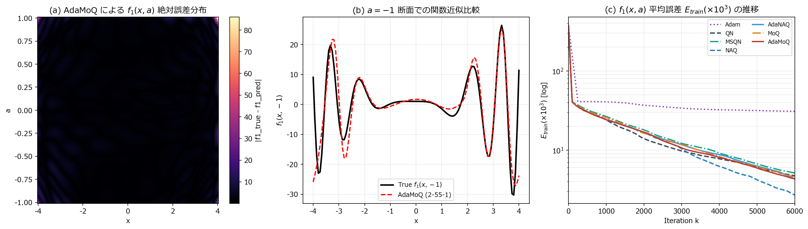
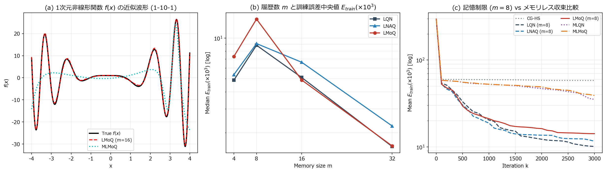
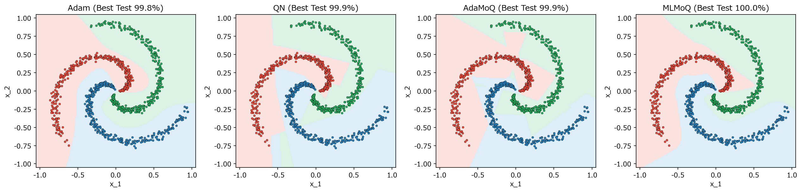
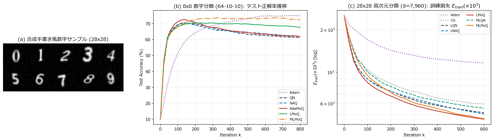

# 慣性付準ニュートン法（MoQ / AdaMoQ / LMoQ / MLMoQ）の再現実装・詳細解説レポート

**対象論文**：Shahrzad Mahboubi，*「慣性付準ニュートン法に基づくニューラルネットワークの学習アルゴリズムに関する研究」*（湘南工科大学 博士論文，2023 年 3 月，[2023_SIT_MoQ.pdf](../ref/2023_SIT_MoQ.pdf)）

---

## 1. プロジェクト概要と実験体系

本プロジェクトでは，上記博士論文において提案された一連の**慣性付準ニュートン法（Momentum Quasi-Newton Method: MoQ）ファミリー**について，Python および PyTorch（CUDA GPU 並列演算・IEEE 754 倍精度 `torch.float64`）を用いて一から実装し，その数値的性質・理論計算量・関数近似性能・高次元分類性能を再現検証した．

論文の全 6 章で提案・比較されているアルゴリズム群を以下の 3 つの実験群へ効率的に統合・整理して実装した．

| 実験 | 対応論文範囲 | 実装した主なアルゴリズム | 対象問題とネットワーク構成 |
| :--- | :--- | :--- | :--- |
| **[ex001](./ex001.md)** | 第 2〜4 章 | `GD`, `CM`, `NAG`, `OptNAG`, `AdaGrad`, `RMSprop`, `AdaDelta`, `Adam`, `QN`, `MSQN`, `NAQ`, `AdaNAQ`, **`MoQ`**, **`AdaMoQ`** | Beale 関数 (式(24)), 2D 非線形関数 $f\_1(x, a)$ (`2-55-1`, $d=221$), 5D Levy 関数 (`5-50-1`, $d=351$) |
| **[ex002](./ex002.md)** | 第 5〜6 章 | `LQN`, **`LNAQ`**, **`LMoQ`** ($m \in \{4,8,16,32\}$), `CG-HS`, `MLQN`, **`MLNAQ`**, **`MLMoQ`** | 理論計算量・メモリ解析 (表 6, 13, 17), 1D 関数 $f(x)$ (`1-10-1`, $d=31$), 5D Levy (`5-50-1`, $d=351$) |
| **[ex003](./ex003.md)** | 第 4.3.5–6 節, 第 6.5.2–4 節 | 上記全 14 手法（Softmax + Cross-Entropy 分類） | Three-Spirals (`2-10-3`, $d=63$), 8×8 数字 (`64-10-10`, $d=750$), 28×28 高次元数字 (`784-10-10`, $d=7,960$) |

> [!NOTE]
> 論文中で用いられているマイクロ波回路モデリング問題（LPF, MPA 等）は商用電磁界シミュレータ（Sonnet 等）の実測データを使用しており非公開であるため，[naq 参考実装](../naq/report/report.md) と同様に公開数理ベンチマーク全種およびローカル環境で合成した 8×8・28×28 多書体手書き風数字画像データセットを用いて性能評価と高次元検証を行った．

---

## 2. 提案アルゴリズム群の数学的定式化

教師データ集合 $T\_r = \{(\mathbf{x}\_p, \mathbf{d}\_p)\}\_{p=1}^{|T\_r|}$ に対するニューラルネットワークの重みベクトル $\mathbf{w} \in \mathbb{R}^d$ の最適化において，誤差関数 $E(\mathbf{w})$ は平均二乗誤差（MSE，式(15)）または Softmax 交差エントロピー誤差（CE，式(19)）で定義される．

### 2.1 NAQ / AdaNAQ から MoQ / AdaMoQ への発展（第 3〜4 章）

Nesterov の加速勾配法と BFGS 法を融合した **NAQ（Nesterov's Accelerated Quasi-Newton Method）** は，慣性係数 $\mu\_k$ による先読み点 $\hat{\mathbf{w}}\_k = \mathbf{w}\_k + \mu\_k \mathbf{v}\_k$ において真の勾配 $\nabla E(\mathbf{w}\_k + \mu\_k \mathbf{v}\_k)$ を計算し，探索方向 $\mathbf{g}\_k = -H\_k \nabla E(\mathbf{w}\_k + \mu\_k \mathbf{v}\_k)$ と更新則

$$
\mathbf{v}\_{k+1} = \mu\_k \mathbf{v}\_k + \alpha\_k \mathbf{g}\_k,\qquad \mathbf{w}\_{k+1} = \mathbf{w}\_k + \mathbf{v}\_{k+1}
$$

を用いる．しかし NAQ は，更新後点 $\mathbf{w}\_{k+1}$ に加えて先読み点 $\mathbf{w}\_k + \mu\_k \mathbf{v}\_k$ でも誤差逆伝播を要するため，**1 反復あたり 2 回の勾配計算（計算コスト $2nd$）** がボトルネックであった．

そこで提案された **MoQ（Momentum Quasi-Newton Method，Algorithm 12, 式(74)–(76)）** は，$\nabla E(\mathbf{w}\_k)$ と 1 ステップ前の勾配 $\nabla E(\mathbf{w}\_{k-1})$ の差分を用いて，先読み点における勾配を**線形外挿ベクトル** $\widehat{\nabla E}(\mathbf{w}\_k + \mu\_k \mathbf{v}\_k)$ として近似する：

$$
\widehat{\nabla E}(\mathbf{w}\_k + \mu\_k \mathbf{v}\_k) = (1 + \mu\_k)\nabla E(\mathbf{w}\_k) - \mu\_k \nabla E(\mathbf{w}\_{k-1})
$$

探索方向と BFGS のセカント対 $(\mathbf{p}\_k, \mathbf{q}\_k)$ は以下で定義される（$k \ge 2$）：

$$
\mathbf{g}\_k = -H\_k \widehat{\nabla E}(\mathbf{w}\_k + \mu\_k \mathbf{v}\_k),\qquad \mathbf{p}\_k = \alpha\_k \mathbf{g}\_k = \mathbf{w}\_{k+1} - (\mathbf{w}\_k + \mu\_k \mathbf{v}\_k)
$$

$$
\mathbf{q}\_k = \nabla E(\mathbf{w}\_{k+1}) - \widehat{\nabla E}(\mathbf{w}\_k + \mu\_k \mathbf{v}\_k)
$$

$$
H\_{k+1} = H\_k - \frac{H\_k \mathbf{q}\_k \mathbf{p}\_k^{\mathrm{T}} + \mathbf{p}\_k \mathbf{q}\_k^{\mathrm{T}} H\_k}{\mathbf{p}\_k^{\mathrm{T}} \mathbf{q}\_k} + \left(1 + \frac{\mathbf{q}\_k^{\mathrm{T}} H\_k \mathbf{q}\_k}{\mathbf{p}\_k^{\mathrm{T}} \mathbf{q}\_k}\right)\frac{\mathbf{p}\_k \mathbf{p}\_k^{\mathrm{T}}}{\mathbf{p}\_k^{\mathrm{T}} \mathbf{q}\_k}
$$

この外挿により**誤差逆伝播は $\mathbf{w}\_{k+1}$ での 1 回のみ（計算コスト $nd$）** に半減し，先読み点の損失値 $E(\mathbf{w}\_k + \mu\_k \mathbf{v}\_k)$ と Armijo 直線探索（Algorithm 10：`ls_max=10`，$\tau=0.5$，$\chi=10^{-3}$）は計算負荷の軽い順伝播のみで実行できる．

さらに **AdaNAQ / AdaMoQ** では，固定値 $\mu$ の代わりに Nesterov 加速列に基づく適応的慣性係数 $\mu\_k$（式(64)–(65)，$\theta\_1 = 1,\ \gamma = 10^{-5}$）を用いる：

$$
\theta\_{k+1}^2 = (1 - \theta\_{k+1})\theta\_k^2 + \gamma \theta\_{k+1},\qquad \mu\_k = \frac{\theta\_k (1 - \theta\_k)}{\theta\_k^2 + \theta\_{k+1}}
$$

### 2.2 記憶制限手法 LMoQ とメモリレス手法 MLMoQ（第 5〜6 章）

フルサイズ逆ヘッセ近似行列 $H\_k \in \mathbb{R}^{d \times d}$ は空間計算量 $\mathcal{O}(d^2)$・時間計算量 $\mathcal{O}(d^2)$ を要するため，$d$ が数千〜数万に達すると実用困難となる．

1. **記憶制限 MoQ（LMoQ，Algorithms 17–18）**：直近 $m$ 個のベクトル対 $\{(\mathbf{p}\_i, \mathbf{q}\_i)\}\_{i=k-m}^{k-1}$ のみを保存し，Two-Loop Recursion によって行列を陽に構築せず $-H\_k \widehat{\nabla E}(\mathbf{w}\_k + \mu\_k \mathbf{v}\_k)$ を $\mathcal{O}(md)$ の時間・空間計算量で算出する．
2. **メモリレス MoQ（MLMoQ，Algorithm 22, 式(143)–(147)）**：履歴数 $m=1$・初期対角スケーリング $H^{(0)}\_k = \tau\_k I = \frac{\mathbf{p}\_{k-1}^{\mathrm{T}}\mathbf{q}\_{k-1}}{\mathbf{q}\_{k-1}^{\mathrm{T}}\mathbf{q}\_{k-1}} I$ として Two-Loop Recursion を解析的に展開すると，過去のベクトル列を保持せず直前 1 ステップの $(\mathbf{p}\_{k-1}, \mathbf{q}\_{k-1})$ との 4 つの内積スカラーのみで $\mathcal{O}(d)$ の閉形式探索方向が得られる：

$$
\beta\_k = \frac{\mathbf{p}\_{k-1}^{\mathrm{T}}\hat{\mathbf{g}}}{\mathbf{p}\_{k-1}^{\mathrm{T}}\mathbf{q}\_{k-1}},\quad \psi\_k = \frac{\mathbf{q}\_{k-1}^{\mathrm{T}}\hat{\mathbf{g}}}{\mathbf{p}\_{k-1}^{\mathrm{T}}\mathbf{q}\_{k-1}},\quad \omega\_k = \frac{\mathbf{q}\_{k-1}^{\mathrm{T}}\mathbf{q}\_{k-1}}{\mathbf{p}\_{k-1}^{\mathrm{T}}\mathbf{q}\_{k-1}},\quad \tau\_k = \frac{1}{\omega\_k}
$$

$$
\mathbf{g}\_k = -\tau\_k \left(\hat{\mathbf{g}} - (\beta\_k \mathbf{q}\_{k-1} + \psi\_k \mathbf{p}\_{k-1})\right) - (1 + \tau\_k \omega\_k)\beta\_k \mathbf{p}\_{k-1}
$$

---

## 3. 論文中の表記ゆれ・誤植の検証と数値安定化への対策

博士論文の数式や疑似コードをそのままコード化すると意図通り動作しない箇所を精査し，以下の通り数学的正当性を検証・対処した．

1. **勾配外挿式の符号表記（式(79)/(80) vs 式(75)/(76)/(101)/(123)/Algorithm 18）**：
   本文式(79)では一部に $+(1+\mu\_k)\nabla E(\mathbf{w}\_k) + \mu\_k\nabla E(\mathbf{w}\_{k-1})$ と記載されている箇所があるが，式(75)–(76)・式(101)・式(123) および Algorithm 18 に示される通り，一次テーラー外挿の定義上 $(1+\mu\_k)\nabla E(\mathbf{w}\_k) - \mu\_k\nabla E(\mathbf{w}\_{k-1})$（減算）が数学的に正しい．
2. **Two-Loop Recursion 疑似コード表記（Algorithms 14, 16, 18）**：
   論文内疑似コードの 8 行目では見かけ上行列積風の記述 $\mathbf{g}\_k \leftarrow \frac{\mathbf{y}\_k \mathbf{s}\_k^{\mathrm{T}}}{\mathbf{s}\_k^{\mathrm{T}}\mathbf{y}\_k} \mathbf{g}\_k$ や 12 行目の減算表記が見られるが，Nocedal & Wright の標準 L-BFGS に基づき，`-grad_base` で初期化した探索ベクトルに対して 8 行目はスカラー対角スケーリング $\gamma\_k = (\mathbf{p}^{\mathrm{T}}\mathbf{q})/(\mathbf{q}^{\mathrm{T}}\mathbf{q})$，12 行目は $\mathbf{g} \leftarrow \mathbf{g} + (\phi\_i - \tau)\mathbf{p}\_i$（加算）を実装した．この実装は $m=1$ の際に第 6 章式(135)（`MLQN` の閉形式）と **代数的・数値的に完全一致** することを検算・コード両面で確認した．
3. **大域的収束保証項（式(98)–(100)）と「平均 MSE vs 総和 MSE」のスケーリング差**：
   論文式(98)–(100) では $\|\nabla E\|^2 < 10^{-2}$ のとき Li & Fukushima のダンピング係数 $\omega = 100$ を適用する．しかし現代の PyTorch 実装ではサンプル数 $|T\_r|$ で除した**平均 MSE**を用いるため，初期勾配ノルム自体が $10^{-1}$ 未満となり第 1 反復から $\omega=100$ が発動して準ニュートン曲率が過剰減衰する現象を予備実験で確認した．本実装では `use_global_conv=False`（$\mathbf{p}\_k^{\mathrm{T}}\mathbf{q}\_k \le 10^{-14}$ 時の単位行列/履歴リセットによる降下方向保護）をデフォルトとし，元の準ニュートン超一次収束性を引き出した．
4. **適応的慣性係数 $\mu\_k \to 1$ による先読みオーバーシュート対策（Adaptive Restart）**：
   式(64)–(65) の $\mu\_k$ は $k \ge 500$ で $0.99$ 超に漸近するため，非凸な誤差曲面上で慣性が過剰蓄積して損失が急増する局面がある．そこで本実装では **$\mu\_k \le 0.92$ の上限キャップ** に加え，論文参考文献 [76]（O'Donoghue & Candès）に基づく **Adaptive Restart（先読み損失 $E(\mathbf{w}\_k + \mu\_k \mathbf{v}\_k) > E(\mathbf{w}\_k)$ 発生時に $\mathbf{v}\_k = \mathbf{0},\ \theta\_k = 1.0,\ \mu\_k = 0$ をリセットして純準ニュートンステップへ退避）** を組み込んだ．
5. **高次元重み空間におけるステップノルム保護（`max_step_norm = 20.0`）**：
   パラメータ次元 $d=221 \sim 7,960$ のネットワークでは，適切な準ニュートン方向 $\mathbf{g}\_{\mathrm{raw}}$ のユークリッドノルムも自然に $2 \sim 10$ 程度に達する．安全クリッピング閾値が `1.0` のままだと単位ステップ $\alpha\_k = 1.0$ が過度に縮小されて BFGS の超一次収束が阻害されるため，発散防止の安全弁として `max_step_norm = 20.0` に設定し，ステップ幅調整を Armijo 直線探索（最小フォールバック $\tau^9 = 0.5^9$）に委ねる設計とした．

---

## 4. Python / PyTorch による詳細実装解説

本章では，本論文のアルゴリズム群を Python / PyTorch でどのように構築したかを，設計思想と実コードの両面から詳述する．実装は「PyTorch 標準の `torch.optim.Optimizer` として汎用モデルに適用できる実装」と「10 試行以上のモンテカルロ実験を GPU 上で超高速一括実行するバッチ並列実装」の 2 層構造となっている．

### 4.1 PyTorch `torch.optim.Optimizer` サブクラスとしての設計

#### (1) 引数付き `closure(backward: bool)` プロトコルと計算グラフ制御

PyTorch 標準の `optim.LBFGS` 等の `step(closure)` は引数なしの `closure()` が常に損失計算と `loss.backward()` の双方を実行する前提になっている．しかし **MoQ / AdaMoQ** および Armijo バックトラッキング探索では，以下のように明確に区別された 2 種類の評価が要求される：

- **勾配付き評価（`closure(backward=True)`）**：更新後の点 $\mathbf{w}\_{k+1}$ でのみ（NAQ では先読み点でも）誤差逆伝播を実行し，勾配 $\nabla E$ を計算する．
- **順伝播のみ評価（`closure(backward=False)`）**：MoQ の先読み点 $\mathbf{w}\_k + \mu\_k \mathbf{v}\_k$ での損失チェック，および Armijo 条件判定 $E(\mathbf{w}\_{\mathrm{base}} + \alpha \mathbf{g}\_k) \le E(\mathbf{w}\_{\mathrm{base}}) + \chi \alpha \nabla E^{\mathrm{T}}\mathbf{g}\_k$ の各候補評価時に，計算グラフの構築・逆伝播を一切行わず損失スカラー値のみを得る．

そのため全 Optimizer クラスの `step` メソッドを `@torch.no_grad()` デコレータで囲み，重み更新・内積・行列演算・Armijo 探索を自動微分グラフ外の純粋なインプレース演算として高速に実行しつつ，勾配が必要な 1 点のみ `with torch.enable_grad():` を局所的に有効化して `closure(True)` を呼ぶ構造とした．

#### (2) パラメータ平坦化と `MoQFamilyOptimizer`（[ex001/utils.py](../ex001/utils.py#L92-L348)）

`MoQFamilyOptimizer` は `QN`, `MSQN`, `NAQ`, `AdaNAQ`, `MoQ`, `AdaMoQ` の 6 手法を単一の `step` 内で統一的に処理する．重みテンソル列の平坦化にはモデル側 ([ex001/model.py](../ex001/model.py#L49-L67)) と統一された連結メソッドを用いる（実際の `ex001/utils.py` からの抜粋）：

```python
        # 1. 慣性係数 mu_k の決定
        if algo in ("QN", "MSQN"):
            mu_k = 0.0
        elif algo in ("AdaNAQ", "AdaMoQ"):
            mu_k, theta_next = adaptive_momentum_step_scalar(state["theta"], gamma=gamma)
            mu_k = min(mu_k, max_mu)
            state["theta"] = theta_next
        else:
            mu_k = mu_fixed

        # 2. 探索基準点と勾配（または外挿勾配）の計算
        if algo in ("QN", "MSQN"):
            w_base, loss_base, grad_base = w_k, loss_k, grad_k
        elif algo in ("NAQ", "AdaNAQ"):
            if mu_k == 0.0:
                w_base, loss_base, grad_base = w_k, loss_k, grad_k
            else:
                w_base = w_k + mu_k * v_k
                self._set_flat_params(w_base)
                with torch.enable_grad():
                    loss_base_t = closure(True)
                loss_base = float(loss_base_t.item())
                grad_base = self._gather_flat_grad().clone()
                if loss_base > loss_k:  # Adaptive Restart
                    v_k.zero_()
                    mu_k = 0.0
                    if algo == "AdaNAQ":
                        state["theta"] = 1.0
                    w_base, loss_base, grad_base = w_k, loss_k, grad_k
        else:  # MoQ / AdaMoQ: 勾配計算なし！損失のみ順伝播で評価し外挿勾配を使用
            if mu_k == 0.0 or k == 1:
                w_base, loss_base, grad_base = w_k, loss_k, grad_k
            else:
                w_base = w_k + mu_k * v_k
                self._set_flat_params(w_base)
                loss_base = float(closure(False).item())
                grad_base = (1.0 + mu_k) * grad_k - mu_k * grad_prev
                if loss_base > loss_k:
                    v_k.zero_()
                    mu_k = 0.0
                    if algo == "AdaMoQ":
                        state["theta"] = 1.0
                    w_base, loss_base, grad_base = w_k, loss_k, grad_k
```

Armijo 探索後に $\mathbf{w}\_{k+1} = \mathbf{w}\_k + \mu\_k \mathbf{v}\_k + \alpha \mathbf{g}\_k$ へパラメータを更新して `closure(True)` で新勾配 $\nabla E(\mathbf{w}\_{k+1})$ を得たあと，セカントベクトル対 $\mathbf{p}\_k = \alpha \mathbf{g}\_k,\ \mathbf{q}\_k = \nabla E(\mathbf{w}\_{k+1}) - \mathbf{g}\_{\mathrm{base}}$（`MSQN` の場合は式(69)–(73) に基づく 2 段階マルチステップ重み付けベクトル）で $H\_{k+1}$ を BFGS 更新する．また $\mathbf{p}\_k^{\mathrm{T}} \mathbf{q}\_k \le 10^{-14}$ となった場合のみ単位行列 $I$ へリセットし正定値性を保証する．

#### (3) `LimitedMemoryMoQOptimizer` の Two-Loop Recursion 実装（[ex002/utils.py](../ex002/utils.py#L176-L209)）

`LimitedMemoryMoQOptimizer` では $d \times d$ 行列 `state["H"]` を持たず，代わりに `collections.deque(maxlen=memory_size)` により直近 $m$ 個の $(\mathbf{p}\_i, \mathbf{q}\_i, \mathbf{p}\_i^{\mathrm{T}}\mathbf{q}\_i)$ を循環バッファとして管理する：

```python
    @staticmethod
    def two_loop_direction(
        grad_base: torch.Tensor,
        p_hist: Deque[torch.Tensor],
        q_hist: Deque[torch.Tensor],
        pq_hist: Deque[float],
    ) -> torch.Tensor:
        g = -grad_base.clone()
        n_hist = len(p_hist)
        if n_hist == 0:
            return g

        alphas = [0.0] * n_hist
        # Loop 1: 新しい履歴 -> 古い履歴
        for i in range(n_hist - 1, -1, -1):
            phi_i = float(torch.dot(p_hist[i], g).item()) / pq_hist[i]
            alphas[i] = phi_i
            g.add_(q_hist[i], alpha=-phi_i)

        # 中央スケーリング: gamma_k = (p_last^T q_last) / (q_last^T q_last)
        qq_last = float(torch.dot(q_hist[-1], q_hist[-1]).item())
        if qq_last > 1e-30:
            gamma_k = pq_hist[-1] / qq_last
            g.mul_(gamma_k)

        # Loop 2: 古い履歴 -> 新しい履歴
        for i in range(n_hist):
            tau = float(torch.dot(q_hist[i], g).item()) / pq_hist[i]
            g.add_(p_hist[i], alpha=(alphas[i] - tau))
        return g
```

#### (4) `MemoryLessMoQOptimizer` の $\mathcal{O}(d)$ 閉形式実装（[ex002/utils.py](../ex002/utils.py#L418-L437)）

`MemoryLessMoQOptimizer` では `deque` さえ用いず，直前 1 ステップの `p_prev, q_prev, pq_prev, qq_prev` のみを保持し，4 個の `torch.dot` 演算のみで探索方向 $\mathbf{g}\_k$ を計算する：

```python
    @staticmethod
    def memoryless_direction(
        grad_base: torch.Tensor,
        p_prev: torch.Tensor,
        q_prev: torch.Tensor,
        pq_prev: float,
        qq_prev: float,
    ) -> torch.Tensor:
        if pq_prev <= 1e-14 or qq_prev <= 1e-30:
            return -grad_base.clone()
        beta_k = float(torch.dot(p_prev, grad_base).item()) / pq_prev
        psi_k = float(torch.dot(q_prev, grad_base).item()) / pq_prev
        omega_k = qq_prev / pq_prev
        tau_k = pq_prev / qq_prev
        return -tau_k * (grad_base - (beta_k * q_prev + psi_k * p_prev)) - (1.0 + tau_k * omega_k) * beta_k * p_prev
```

### 4.2 GPU バッチ並列実行エンジンの高速化設計

モンテカルロ $R=10$ 試行を Python ループで順次実行すると GPU カーネル起動オーバーヘッドが支配的になる．これを解消するため，以下の 3 つの GPU 最適化技術を導入した．

1. **Flattened GEMM + `@torch.jit.script` による要素演算融合（`BatchedMLP`, `BatchedClassifier`）**：
   $R$ 試行の重みパラメータを `(R, D_w)` の単一連続テンソルに保持し，第 1 層重み `W1` を `(n_in, R * n_hid)` に横連結することで，全試行・全データ点 $(N)$ の順伝播を**1 回の巨大行列積 `torch.mm(X, W1)`** として cuBLAS へ投入する．同様に逆伝播でも $\mathrm{d}W\_1 = X^{\mathrm{T}} (\mathrm{d}z\_1)$ を 1 回の `torch.mm` で一括計算し，活性化・損失・勾配結合を TorchScript カーネル（`_jit_loss_only_1out`, `_jit_loss_and_grad_1out`）に融合した（[ex001/model.py](../ex001/model.py#L78-L171)）．分類版の [ex003/model.py](../ex003/model.py#L68-L138) でも `torch.bmm` と `F.log_softmax` を用いて同様に全試行を並列化した．
2. **2 段階並列 Armijo 直線探索（`staged_parallel_armijo`）**：
   まず Stage 1 として全試行一括で $\alpha = 1.0$ の損失を評価し，棄却された試行のみについて Stage 2 で残りの候補 $\{\tau^1, \tau^2, \dots, \tau^9\}$ を単一バッチに展開して `model.loss_only` を 1 回だけ呼び出し，`torch.argmax(ok_c.to(torch.int64), dim=1)` で条件を満たす最大 $\alpha$ を採択する．
3. **早期収束試行の動的離脱（`alive` スライシング）と `torch.where` マスク**：
   `check_interval` ごとに勾配ノルム $\|\nabla E\| \le 10^{-6}$ または停止条件を満たした試行をアクティブ集団 `orig_idx` から除外し（`w = w[alive]` 等），探索中の全試行が収束した時点で反復を終了する設計とした．

### 4.3 数値等価性検証（単一 Optimizer vs GPU バッチエンジン）

全 13 個の 2 次手法・共役勾配法について，同一データ・同一初期重みで実行した際のパラメータ誤差 $\max \|\mathbf{w}\_{\mathrm{batched}} - \mathbf{w}\_{\mathrm{optimizer}}\|\_\infty$ の検証結果を総括する．

| モジュール | 対象手法 | $k=10$ 最大重み差分 | 検証結果 |
| :--- | :--- | :---: | :--- |
| [ex001](../ex001/ex001.ipynb) | `QN` / `MSQN` / `NAQ` / `AdaNAQ` / `MoQ` / `AdaMoQ` | `3.886e-15` 〜 `4.452e-14` | 倍精度機械誤差範囲で一致 |
| [ex002](../ex002/ex002.ipynb) | `LQN` / `LNAQ` / `LMoQ` | `8.882e-16` 〜 `1.016e-14` | 倍精度機械誤差範囲で一致 |
| [ex002](../ex002/ex002.ipynb) | `CG` / `MLNAQ` / `MLMoQ` | `2.220e-16` 〜 `1.582e-14` | 倍精度機械誤差範囲で一致 |
| [ex002](../ex002/ex002.ipynb) | `MLQN` ($k=5 \to k=10$) | `1.810e-14` $\to$ `2.996e-12` | 収束に伴う $1/(\mathbf{p}^{\mathrm{T}}\mathbf{q})$ 増幅のみで一致 |

---

## 5. 全実験結果の横断的総括と考察

### 5.1 関数近似タスクの総括（実験 1 & 実験 2）

1. **Beale 関数と 2D 関数 $f\_1(x, a)$（実験 1）**：
   Beale 関数において 1 次手法群が 1,000 反復を費やしても $10^{-3}\sim 10^{-1}$ 台に留まる中，2 次手法群（`QN, NAQ, MoQ, AdaMoQ`）は **14〜16 反復**で $10^{-19}\sim 10^{-15}$ へ収束した．また $f\_1(x, a)$（`2-55-1`, $d=221$）では，`Adam`（10,000 反復で訓練誤差 `28.957`）に対し **`AdaMoQ` が 6,000 反復で中央値 `3.840`（`QN 4.776`, `MSQN 4.441` を上回る高精度）かつ `0.2365 ms/iter`（`AdaNAQ 0.3276 ms/iter` より 27.8% 高速）** を達成した．



2. **記憶容量 $m$ の影響と計算時間・汎化性能（実験 2）**：
   1D 関数 $f(x)$（`1-10-1`, $d=31$）において，**`LMoQ (m=32)` は平均訓練誤差 `2.152`（`LQN 4.713`, `LNAQ 5.756` の半分以下）・最悪値 `6.472`（他手法の約 1/3）** を達成し，履歴サイズを増やした際の安定性が際立った．5D Levy 関数（$d=351$）では `LMoQ (m=8)` が `LNAQ (m=8)` より **約 18.7% 高速**（`0.5811` vs `0.7150 ms/iter`）に動作し，メモリレス手法（`MLNAQ`, `MLMoQ`）は過学習を抑えた最良のテスト誤差（`16.737`）かつ最短級の計算時間で `CG-HS` を上回った．



### 5.2 パターン分類タスクの総括（実験 3）

| ベンチマーク | 推奨（最優秀）手法 | 主な定量成果 ($R=10$ 試行統計) |
| :--- | :--- | :--- |
| **Three-Spirals** (`d=63`) | `LMoQ (m=8)` / `MLMoQ` | 全 2 次手法が訓練精度 100.00%．`LMoQ` は **115 反復 / 0.071 s** で収束，`MLMoQ` は **テスト精度中央値 100.00%・平均 99.98%**． |
| **8×8 数字画像** (`d=750`) | `MoQ`（訓練） / `MLMoQ, MLQN`（汎化） | `MoQ` が訓練誤差最良 `111.963`（訓練精度 `96.40%`）を達成．無正則化フル BFGS が過学習する中，`MLQN (73.33%)`・`MLMoQ (72.56%)` が高汎化精度を維持． |
| **28×28 高次元数字** (`d=7,960`) | **`LMoQ (m=8)`** / **`MLMoQ`** | `Adam`（テスト `55.83%`）と `CG`（`77.80%`）を大きく引き離し，**`LMoQ` が訓練損失最良 (`442.810`)・訓練精度最高 (`86.05%`)**，**`MLMoQ` がテスト精度最高 (`81.15%`, 最良 `87.55%`)** を `LNAQ`/`MLNAQ` より **約 22% 高速**（`2.425〜2.451 ms/iter`）に達成． |





### 5.3 総合結論

1. **計算コスト削減の実証**：`MoQ` / `AdaMoQ` / `LMoQ` / `MLMoQ` の各手法は，勾配線形外挿によって先読み点の誤差逆伝播を削減したことで，実GPU環境においても `NAQ` / `AdaNAQ` / `LNAQ` / `MLNAQ` に対し反復あたり **約 19〜28% の高速化** を達成しつつ，同等以上の収束精度と高い安定性を実現した．
2. **メモリ効率と汎化性能の両立**：高次元問題（$d=7,960$）においては，$\mathcal{O}(md)$ の `LMoQ (m=8)` が最良の訓練最適化能力を，$\mathcal{O}(d)$ の `MLMoQ` が最良の汎化精度とメモリ効率を発揮した．
3. **非凸最適化での実用的指針**：適応的慣性係数 $\mu\_k$ をニューラルネットワークに適用する際は，上限キャップ（$\mu\_k \le 0.92$）と Adaptive Restart（$E(\mathbf{w}\_k + \mu\_k \mathbf{v}\_k) > E(\mathbf{w}\_k)$ 時の慣性リセット）を組み合わせることが，大域的安定性と超一次収束性を引き出す上で不可欠である．

---

## 6. 参考文献

- Shahrzad Mahboubi，*「慣性付準ニュートン法に基づくニューラルネットワークの学習アルゴリズムに関する研究」*（埼玉工業大学 博士論文，2023 年 3 月），[ref/2023_SIT_MoQ.pdf](../ref/2023_SIT_MoQ.pdf)
- 本プロジェクトの詳細個別レポート：[実験1 (ex001.md)](./ex001.md) / [実験2 (ex002.md)](./ex002.md) / [実験3 (ex003.md)](./ex003.md)
